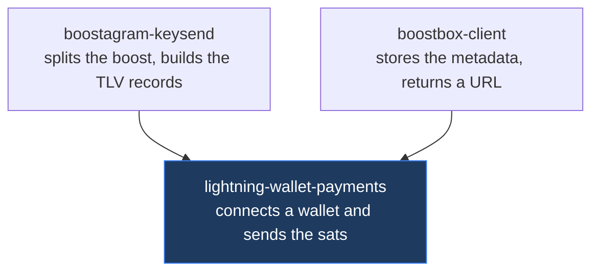

# Recipes

**If you saw something on one of these sites and want it in your own app,
this is the section to point your coding agent at.**

Terms not familiar? → [`../../GLOSSARY.md`](../../GLOSSARY.md).

Each recipe is a directory holding the working code, a manifest describing
what it needs, and a README explaining how to install it and what will break
if you skip a step. The code is byte-identical to what is running in
production — not a tidied-up illustration of it.

## Available now

| Recipe | Tier | Files | Install | Seen on |
|---|---|---|---|---|
| [podcast-feed-parser](podcast-feed-parser/) | wired | 8 | 1 package | [musicsideproject.com](https://musicsideproject.com) |
| [safe-feed-fetch](safe-feed-fetch/) | drop-in | 2 | nothing | [boostmebitch.com](https://boostmebitch.com) |
| [podcast-index-client](podcast-index-client/) | drop-in | 1 | nothing | [boostmebitch.com](https://boostmebitch.com) |
| [musicl-playlist-feed](musicl-playlist-feed/) | drop-in | 2 | nothing | [stablekraft.app/playlist/maker](https://stablekraft.app/playlist/maker) |
| [chapters-json](chapters-json/) | drop-in | 1 | nothing | [boostmebitch.com](https://boostmebitch.com) |
| [pc20-feed-validator](pc20-feed-validator/) | drop-in | 1 | nothing | [itdv.podtards.com/feed-validator](https://itdv.podtards.com/feed-validator) |
| [pwa-install-prompt](pwa-install-prompt/) | drop-in | 2 | nothing | [itdv.podtards.com](https://itdv.podtards.com) |
| [lightning-wallet-payments](lightning-wallet-payments/) | wired | 5 | 3 packages | [itdv.podtards.com](https://itdv.podtards.com) |
| [boostagram-keysend](boostagram-keysend/) | wired | 3 | nothing | nowhere - authored |
| [boostbox-client](boostbox-client/) | wired | 3 | nothing | nowhere - authored |

**Reading feeds starts at [`podcast-feed-parser`](podcast-feed-parser/).** It
takes a string and returns typed data. On a server, get that string with
[`safe-feed-fetch`](safe-feed-fetch/) — a feed URL is user-supplied, and a
plain `fetch` of it is an SSRF hole. [`chapters-json`](chapters-json/) reads
the chapters file a feed points at, [`podcast-index-client`](podcast-index-client/)
looks a feed up in Podcast Index, and
[`musicl-playlist-feed`](musicl-playlist-feed/) writes a playlist of songs from
other feeds.

**Payments start at [`lightning-wallet-payments`](lightning-wallet-payments/).**
That one connects a wallet and sends. The other two ride on top of it:
[`boostagram-keysend`](boostagram-keysend/) attaches boost metadata to a
keysend payment, and [`boostbox-client`](boostbox-client/) stores that metadata
somewhere the payment description can point at.

### The three payment recipes stack

**Start at the bottom.** `lightning-wallet-payments` is the one that moves
money; the other two decide what rides along with it. Installing either of them
without it gives you records and URLs and no way to pay anybody.

## One recipe has been withdrawn

There was an **image proxy** here. A security review of this repo found three
bypasses in the SSRF guard the recipe was built around — the guard did not do
what its README said it did. It was removed rather than annotated, because its
entire value was the safety it did not provide.

What was wrong, and what a correct guard needs:
[`../comparisons/image-proxy-ssrf.md`](../comparisons/image-proxy-ssrf.md).

## Where the code came from, per file

Three states, declared per file in `feature.json` and checked by
`../check-recipes.sh` step 2. This matters more than the tier: it is the
difference between a promise the catalog can keep and one it cannot.

- **`extracted`** — byte-identical to a live site. `../PROVENANCE.tsv` records
  the commit, and `../check-drift.sh` re-checks it.
- **`patched`** — a live-site file plus a named security fix the site does not
  have. `feature.json` lists what diverged and why. Do not diff it against the
  site and "correct" the difference.
- **`authored`** — written for this catalog. **No site runs it**, so it cannot
  make the promise every other page here makes, and its README says so in the
  first line. It exists where the feature was worth having and extraction was
  impossible.

`authored` code ships its own tests, because there is no production traffic
vouching for it.

## Tiers, so you know what you're agreeing to

- **drop-in** — one or two files, no packages to install. Copy, rename the
  handful of constants the README names, done.
- **wired** — needs packages, environment variables and usually a React
  provider or an API route. Still mechanical, but there are steps to miss.
- **not-portable** — documented but not shipped, because the honest file count
  makes copying a worse idea than reading. The now-playing bar pulls **20
  files and 7,438 lines**; a recipe claiming otherwise would waste more of
  your time than no recipe at all.

## For an agent

[`index.json`](index.json) lists every recipe in one file — name, tier,
summary, packages, environment variables, and where its manifest and README
are. It is generated from the manifests by `../check-recipes.sh --write-index`
and checked on every run, so it cannot fall behind them.

Then read `<recipe>/feature.json`. It is the machine-readable half and carries
everything needed to install without parsing prose:

| Field | Use |
|---|---|
| `tier` | `drop-in` \| `wired` \| `not-portable` |
| `files[]` | `{from, to}` — `to` is the path in the target repo. `from` may be in a subfolder of `files/` when the files import each other by relative path; keep that layout |
| `dependencies` | npm packages to install; `{}` means none |
| `peer` | framework versions assumed |
| `env` | environment variables to set |
| `rename` | **app-specific constants that must be changed**, with file and line |
| `caveats` | what breaks, and the non-obvious prerequisites |
| `source` | repo, ref and commit the code was taken from |

**Do not skip `rename`.** These files come from real sites, so they carry
real app names. Copying `pwa-install-prompt` unchanged offers your users an
app called DoerfelVerse.

## What these recipes are held to

`../check-recipes.sh` enforces all of it, and `--network` also confirms every
"seen on" link still answers:

1. Code comes only from one of the five live sites. A recipe promises the
   feature already works somewhere, and code that has never served real
   traffic cannot make that promise.
2. Every file a recipe lists exists, and every file on disk is listed.
3. No `@/…` import goes unshipped, and every relative import resolves inside
   the recipe's own `files/`. An unshipped import is the difference between
   "just add it" and an import error in your repo.
4. No recipe references a secret in a `NEXT_PUBLIC_` variable — those are
   bundled into public JavaScript.
5. Every app-specific constant appears in `rename`.
6. No recipe links to a dead or superseded URL.
7. `index.json` matches the manifests.

## Related

- [`../modules/`](../modules/) — shared source used across features, extracted
  the same way.
- [`../comparisons/`](../comparisons/) — why each canonical copy won. Written
  for the maintainer, not for you.
- [`../analysis/`](../analysis/) — the scripts that produced every number here.
